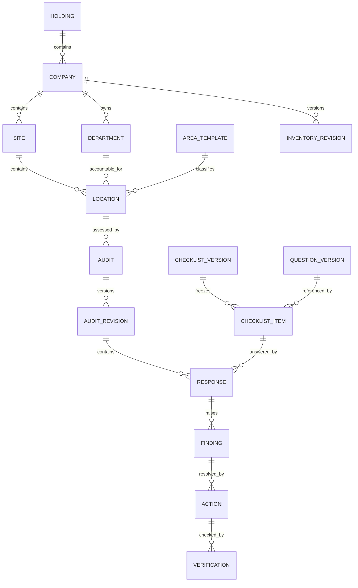

# معماری هدف و محدوده نمونه

نمونه مرورگری فعلی به‌منظور بررسی تعامل انتخاب موارد و محتواست. معماری عملیاتی هدف یک برنامه ماژولار با پایگاه داده رابطه‌ای، مخزن خصوصی فایل و worker خروجی/اعلان است. انتخاب نهایی پشته سرور هنوز باز است؛ جزئیات در سند فارسی موجود است.

## انتخاب موارد

`company_area_selection` وجود یک نوع محل در شرکت را مشخص می‌کند. `site_area_selection` زیرمجموعه انتخاب شرکت است. `location` مصداق واقعی با مالک و محدوده است؛ یک عنوان می‌تواند چند مصداق داشته باشد. نبود سایت اعلام‌شده با ساخت سایت فرضی پوشانده نمی‌شود.

نسخه فهرست شامل دامنه، انتخاب‌ها، وضعیت، علت، عامل، زمان اثر و نسخه قبلی است. نسخه پیش‌نویس از نسخه مؤثر جداست. هنگام تأیید، محدودیت زیرمجموعه، نسخه مورد انتظار و برنامه‌های باز در یک تراکنش بررسی شوند. حذف مورد فعال سایت از شرکت تا تعیین تکلیف سایت رد شود.

در نمونه، کنترل نسخه و محدودیت سایت وجود دارد؛ تاریخ اثر، احراز عامل و برنامه باز هنوز متعلق به مرحله سرور است.

## مرز چندشرکتی

- روی همه رکوردهای عملیاتی `company_id` وجود داشته باشد و کلیدهای خارجی مرکب از عبور مرز شرکت جلوگیری کنند.
- API، جستجو، گزارش، cache key، worker و دانلود فایل همگی مجوز دامنه را اعمال کنند.
- ارزیاب بین‌شرکتی فقط با grant صریح و دارای تاریخ اعتبار دسترسی بگیرد.
- مدیر هلدینگ ممکن است مجوز آمار تجمیعی داشته باشد اما مجوز عکس‌های جزئی نداشته باشد.
- شناسه درخواست یا company_id ارسالی کلاینت به‌تنهایی مجوز نیست.

## انتشار و امتیاز

نسخه منتشرشده چک‌لیست از هسته مشترک + الگوی تخصصی + استثناهای شرکت تشکیل و ثابت می‌شود. سؤال مشترک دوبار در نسخه نهایی درج نشود. `core_question_version_id` برای مقایسه نگهداری شود.

نمره هر S = `100 * sum(weight * score) / sum(weight * max)`؛ پنج S طبق سیاست نسخه‌دار تجمیع می‌شوند. بی‌پاسخ مانع نتیجه نهایی، صفر پاسخ معتبر، N/A فقط با مجوز و دلیل و تأیید از مخرج خارج است. تمام N/Aها نمره ناموجود می‌دهند. تغییر policy گذشته را بازنویسی نکند.

۱۴۰ قلم فعلی فقط پیش‌نویس پنج‌محوری‌اند. فیلدهای معیار و rubric خالی‌اند و این وضعیت باید مانع انتشار عملیاتی باشد. نمونه محاسبه رابط، پنج سؤال با وزن مساوی و یک سؤال در هر S دارد؛ موتور عملیاتی همه سناریوهای چندسؤالی و استثنا را جدا پوشش خواهد داد.

## عملیات و نگهداری

Snapshot امتیاز و تأیید گزارش اتمیک؛ گزارش تأییدشده ثابت؛ یافته و اقدام بعد از تأیید قابل پیگیری. فایل خصوصی و اسکن‌شده، outbox اعلان پس از commit، ورود اکسل مرحله‌ای و idempotent، پشتیبان هماهنگ DB/شواهد و آزمون بازیابی پیش از تولید لازم است.

